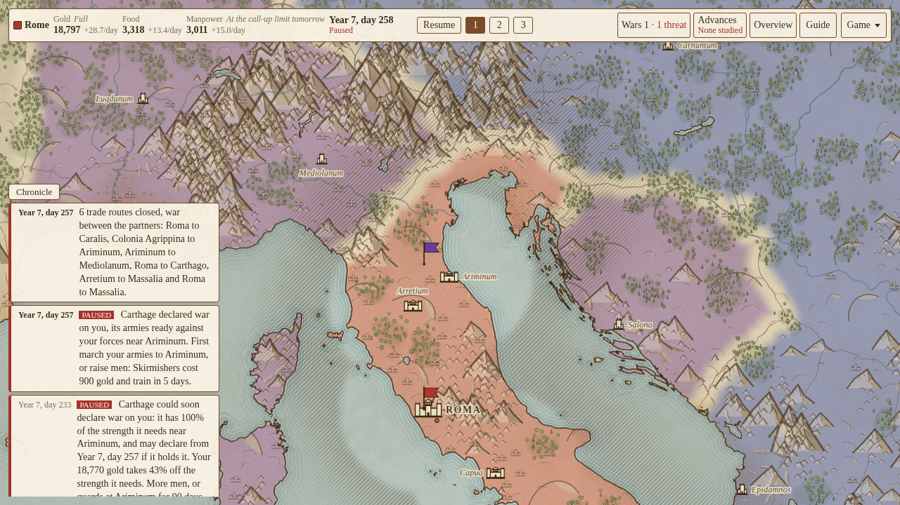
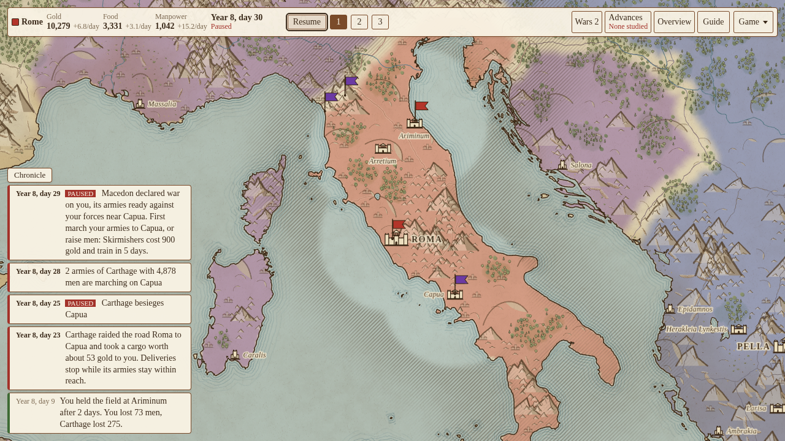
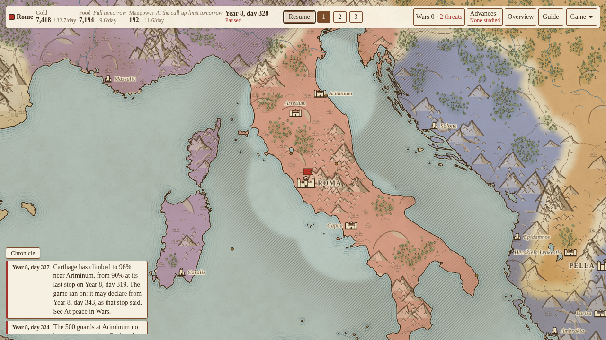
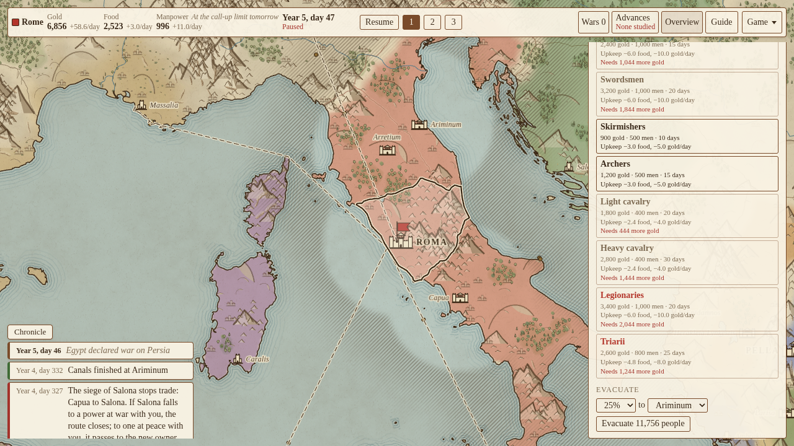
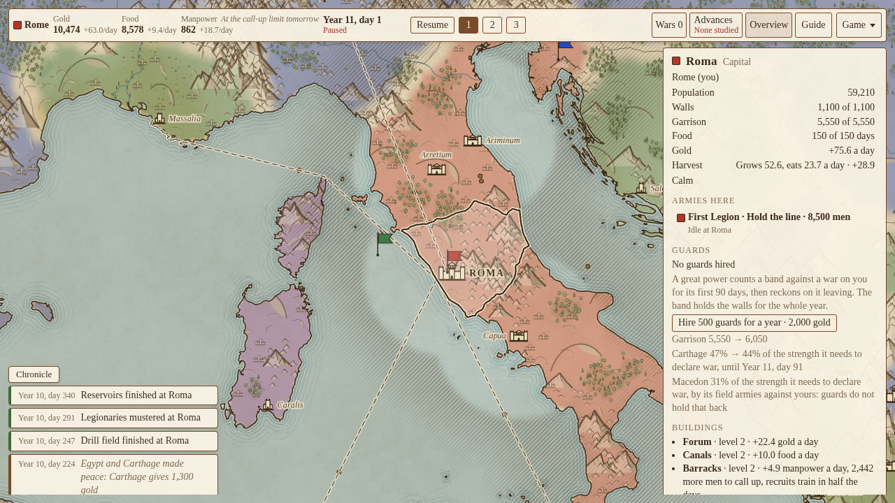
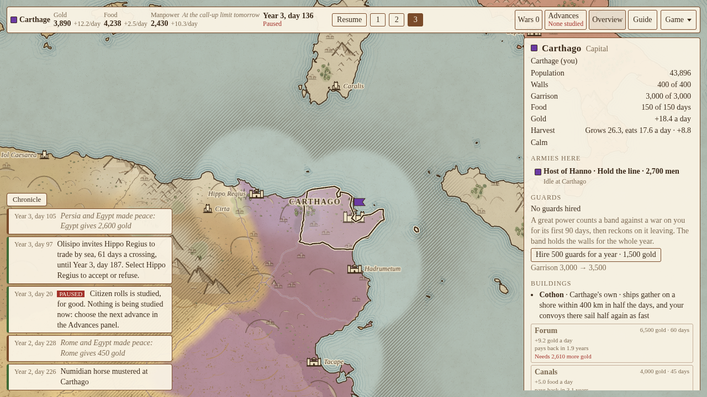
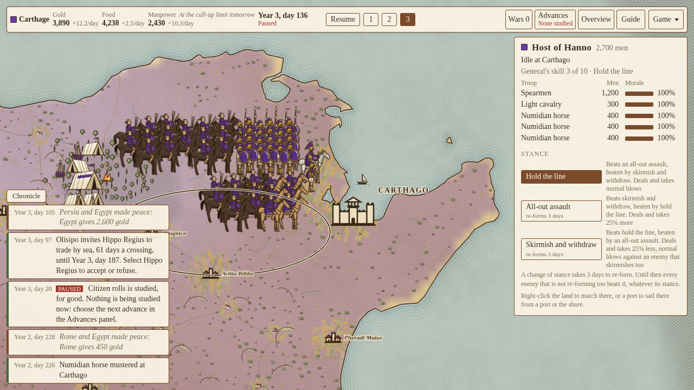
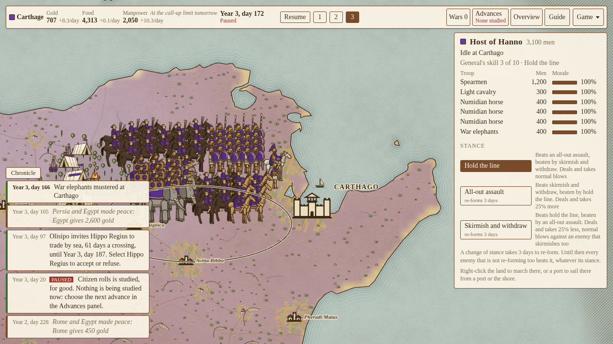

# Captures of playtest/stage-sixteen

- Head: `4dab8f2976698ad22955b1fca35c04c5114a2b9f`
- Compared with: no run of the base branch, so every scenario is published whole

## `round`, new, the base has no captures of it

The full set is in the local `captures/` folder of the machine that published.
