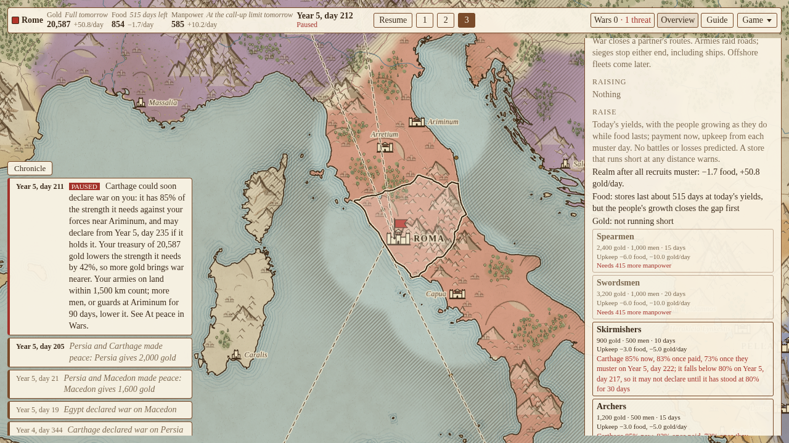
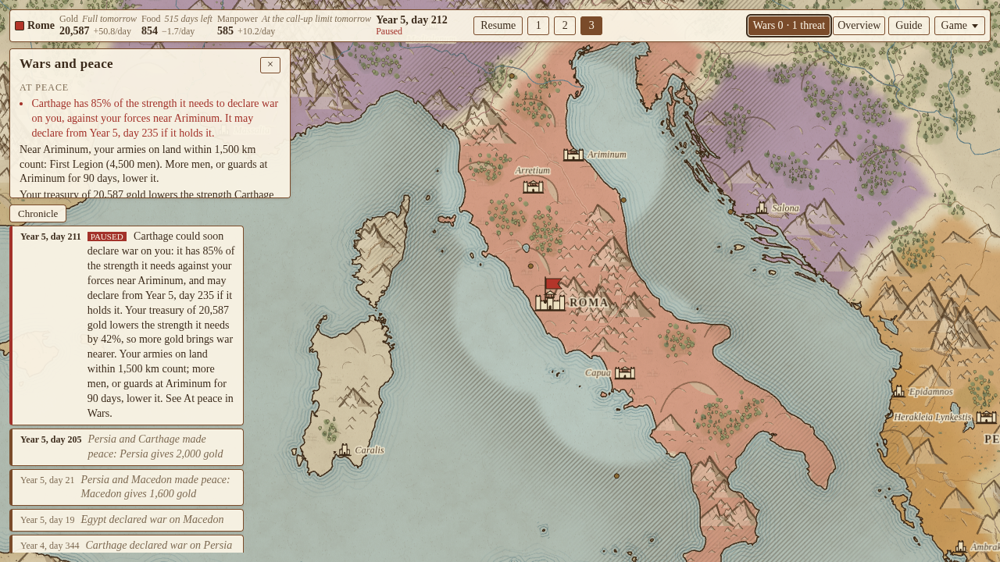
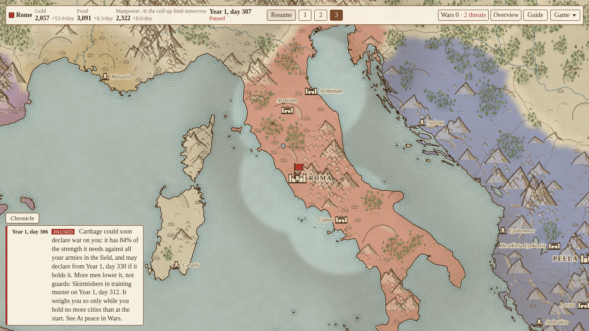
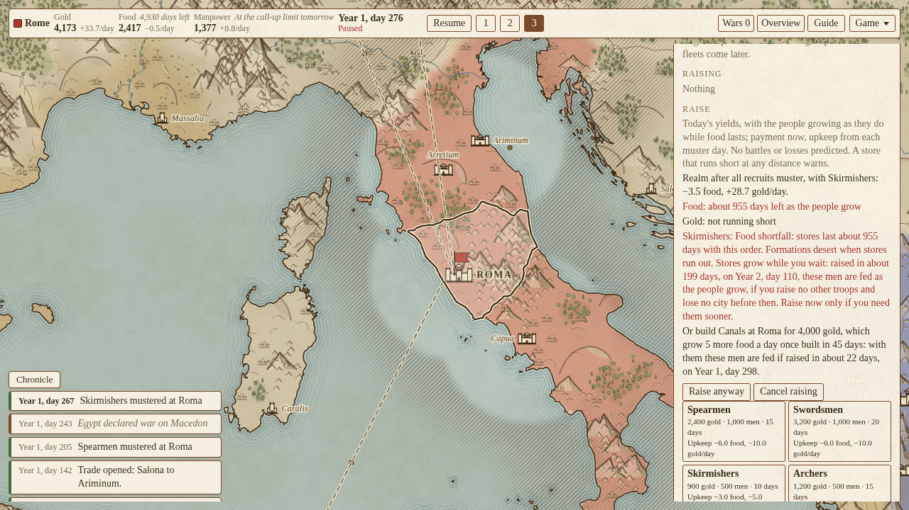
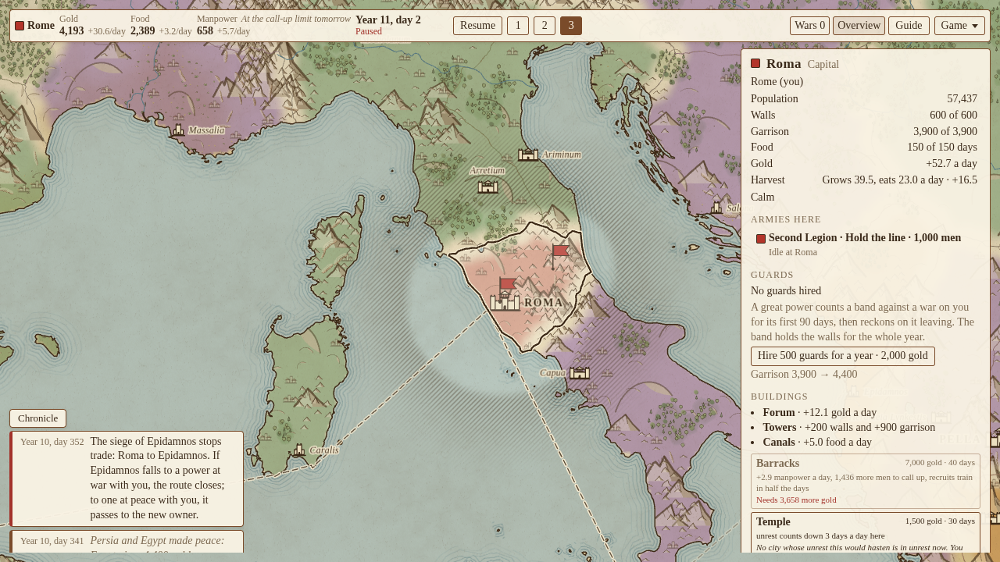
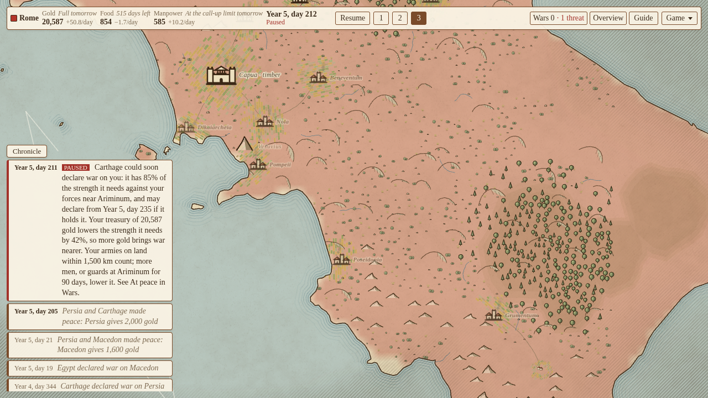
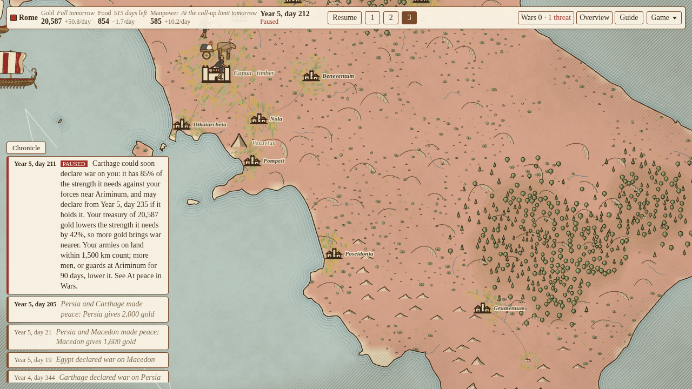

# Captures of playtest/stage-thirteen

- Head: `964398e4d8dd85d47d743e7f10348a2b6c60726e`
- Compared with: no run of the base branch, so every scenario is published whole

## `round`, new, the base has no captures of it

The full set is in the local `captures/` folder of the machine that published.
